# Applika.dev infrastructure

How the parts of Applika connect: where each part runs, who owns each account, and which parts exist
only on `develop` so far. It also lists the accounts that must move to the BorderlessCodingHub.

> **This document holds no password, token or key.** It only says where each secret is stored and
> who can reach it.

Legend:

- **to transfer**: an account in Brunno's or Luis's personal name that must move to Borderless.
- **to confirm with Brunno**: Luis does not have this information; Brunno manages it.

Gathered on 2026-10-19 from the repository (`.github/workflows/`, `backend/app/config/settings.py`,
`backend/app/worker/`, `docker-compose.yml`, `cli/pyproject.toml`, `docs/adr/`) and the owner's answers.

---

## 1. The big picture

Production is one Hostinger VPS running a Docker Swarm stack, plus a Postgres database that Brunno
manages outside it. Traefik receives every request for `applika.dev` and routes it by path: `/api`
goes to the API, everything else goes to the frontend.

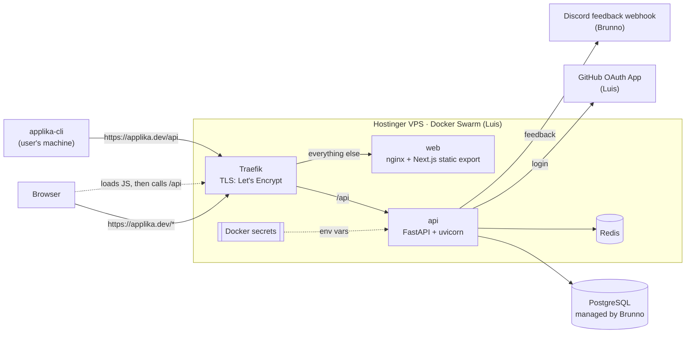

| Part | Runs where | What it does |
|---|---|---|
| Traefik | swarm service on the VPS | TLS termination (Let's Encrypt) and path routing for `applika.dev` |
| `web` | swarm service, image `<DOCKER_HUB_USER>/<frontend image>:latest` | nginx serving the Next.js **static export**. No server-side rendering: the browser downloads the app and calls the API itself |
| `api` | swarm service, image `<DOCKER_HUB_USER>/<backend image>:api-latest` | FastAPI under the `/api` prefix. All business logic, auth, CV PDF rendering (RenderCV + Typst inside the container) |
| Redis | swarm service on the VPS | Refresh-token / login state and the GitHub data cache |
| PostgreSQL | managed database, Brunno's account | All persistent data |
| `applika-cli` | the user's machine, installed from PyPI | Talks to the same API as the web, at `https://applika.dev/api` |

## 2. How a request flows

The browser and the CLI never talk to the database or Redis. Everything goes through the API.

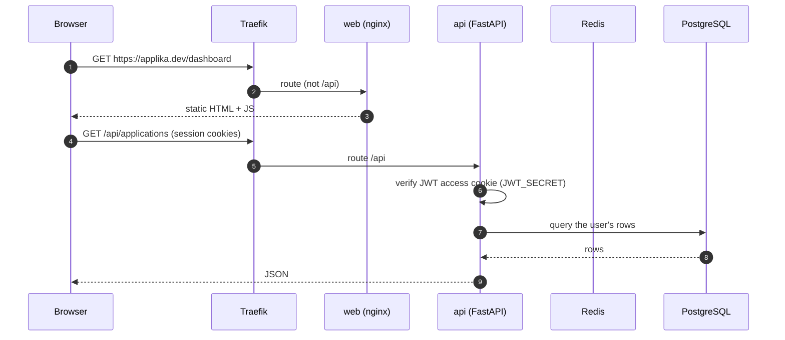

- The frontend's API address (`API_BASE_URL`) is **baked in at build time** by
  `frontend-cd.yaml`, so changing it means rebuilding the `web` image.
- The web and the API share the host `applika.dev`, so the session cookies (`__access`,
  `__refresh`) are sent to the API on every call.
- `ENVIRONMENT=PROD` hides `/api/openapi.json` and `/api/docs`.

## 3. Authentication

GitHub OAuth is the only login ([ADR-0002](adr/0002-github-oauth-sole-login.md)), for both the web and the CLI.

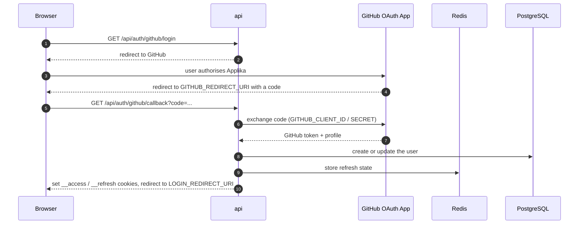

The CLI (`applika login`) uses the same GitHub OAuth App through a hand-off: the API opens the
login in the browser and the CLI receives its tokens at the end. The GitHub token the API keeps is
encrypted with `GITHUB_TOKEN_ENCRYPTION_KEY` (Fernet).

## 4. Database

| Item | Status |
|---|---|
| Engine | PostgreSQL |
| Management | Managed by **Brunno**. Luis has no access to the database or its provider. The API connects through `DATABASE_URL` (Docker secret, section 6.2) |
| Provider / region / instance name | **to confirm with Brunno** |
| Owning account | **Brunno** (personal). **to transfer** |
| Access | Brunno only; the API, through `DATABASE_URL` |
| Migrations | Manual: `alembic upgrade head` inside the API container, then restart (section 5) |
| Backup | **to confirm with Brunno** (provider backups: frequency, retention, how to restore). The repository has no backup routine |
| Schema rollback | `alembic downgrade <previous_revision>` inside the container, point the stack back to the previous image tag, restart |

Migrations follow **expand first, code second**: a release ships an additive migration with code
that still works on the old schema; the code that uses the new objects ships in a later release,
after the migration ran. Upgrades never drop a column or table; retired ones are renamed `_old`, so
a downgrade restores the data.

## 5. Build and deploy

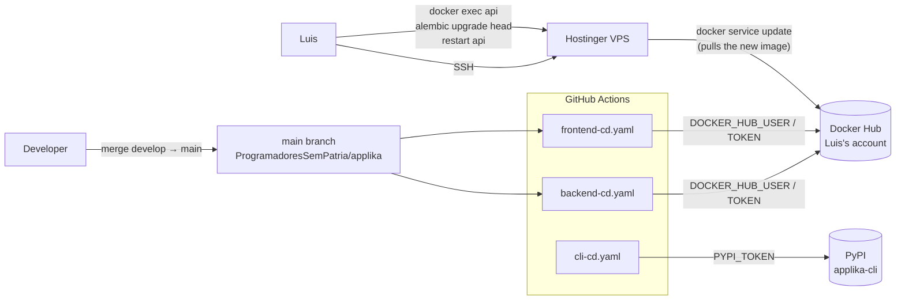

1. A merge to `main` makes GitHub Actions build the images and push them to Luis's Docker Hub
   (tags `api-latest` for the API, `latest` for the frontend).
2. The containers are upgraded by accessing Luis's VPS over SSH (`docker service update`).
3. Migrations are **not** automated: `alembic upgrade head` runs by hand inside the API container,
   then the API restarts. Between steps 2 and 3, the new code runs against the old schema; that is
   why migrations ship expand first.
4. The CLI is published to PyPI by `cli-cd.yaml` (`uv publish`, environment `pypi`).

CI runs on every PR: `backend-ci.yaml` (ruff, pytest), `frontend-ci.yaml` (lint, unit tests, build,
and Playwright e2e against the real stack from `docker-compose.e2e.yml`), `cli-ci.yaml`.

| Item | Status |
|---|---|
| Hosting | **Hostinger** VPS with Docker Swarm |
| VPS owner | **Luis** (personal). **to transfer** |
| Access | Luis only (Hostinger panel and SSH) |
| Image registry | Docker Hub, Luis's personal account (secret `DOCKER_HUB_USER`). **to transfer** |

## 6. Secrets and configuration

There is no Vault, Doppler or Vercel. Secrets live in two places.

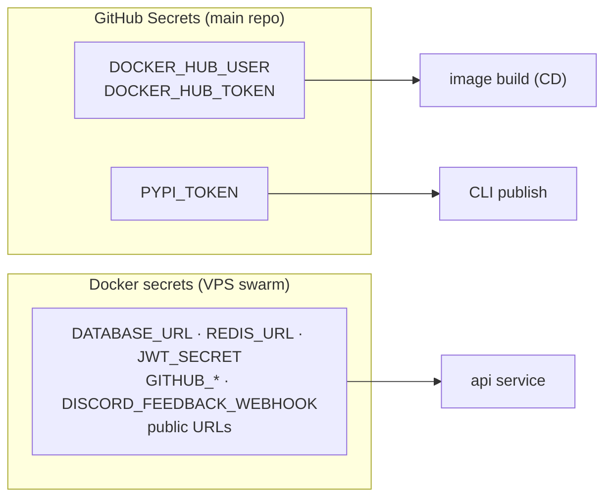

### 6.1 GitHub Secrets (Settings → Secrets and variables → Actions, main repository)

Three secrets. Access: admins of `ProgramadoresSemPatria/applika`. **to transfer** with the repository.

| Name | Purpose | Used in |
|---|---|---|
| `DOCKER_HUB_USER` | Docker Hub user that publishes the images (Luis's personal account) | `backend-cd.yaml`, `frontend-cd.yaml` |
| `DOCKER_HUB_TOKEN` | Docker Hub access token (Luis's personal account) | `backend-cd.yaml`, `frontend-cd.yaml` |
| `PYPI_TOKEN` | publish `applika-cli` to PyPI (environment `pypi`) | `cli-cd.yaml` |

### 6.2 Runtime environment (Docker secrets on the VPS)

Stored as **Docker Swarm secrets** on the VPS (Hostinger, Luis's account). Access: whoever has SSH to
the VPS, today Luis. To list them without reading values: `docker secret ls`.

| Variable | What it is |
|---|---|
| `DATABASE_URL` | Postgres connection |
| `REDIS_URL` | Redis connection |
| `JWT_SECRET` | signs the session JWTs |
| `GITHUB_CLIENT_ID`, `GITHUB_CLIENT_SECRET`, `GITHUB_REDIRECT_URI` | GitHub OAuth (login) |
| `GITHUB_TOKEN_ENCRYPTION_KEY` | Fernet key for the stored GitHub tokens |
| `DISCORD_FEEDBACK_WEBHOOK` | Discord webhook that receives user feedback (feedback only, not reports) |
| `CORS_ORIGINS`, `LOGIN_REDIRECT_URI` | public URLs |
| `ENVIRONMENT=PROD` | configuration |

## 7. Domain and TLS

| Item | Status |
|---|---|
| Domain | `applika.dev` (site) and `applika.dev/api` (API, the CLI's default) |
| Registrar | **Hostinger** |
| Registration owner | **Luis** (personal). **to transfer** |
| DNS | **Hostinger** (same account as the registration) |
| TLS | Let's Encrypt, issued and renewed by Traefik. The certificate is signed with **Luis's personal e-mail**; when migrating, change the e-mail in the Traefik configuration |

## 8. Third-party services

| Service | Use | Provider | Owning account |
|---|---|---|---|
| Login | Only login for the web and the CLI ([ADR-0002](adr/0002-github-oauth-sole-login.md)) | GitHub OAuth App | **Luis** (personal). **to transfer** to the Borderless org |
| Feedback | Users' feedback (`POST /api/feedbacks`) is posted to Discord by the `DISCORD_FEEDBACK_WEBHOOK` webhook (none received so far). Reports do not use this webhook (section 10.4) | Discord | **Brunno** (personal). **to transfer** |
| CV PDF | RenderCV + Typst inside the API container | local | no account |
| E-mail | None: the product sends no e-mail | — | — |
| Analytics | None: the cookie policy states there are no analytics cookies | — | — |
| AI APIs | None: fit score and tailoring are computed in the backend, without an LLM | — | — |

## 9. CLI

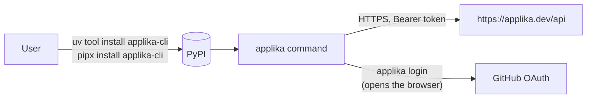

| Item | Status |
|---|---|
| Package | `applika-cli` on **PyPI** (not npm): `pypi.org/project/applika-cli` |
| Publishing | `cli-cd.yaml` with `uv publish`, token `PYPI_TOKEN` in environment `pypi` |
| Authors in the package | Luis Eduardo Soares, David Alecrim (`cli/pyproject.toml`) |
| PyPI owner | **Luis** (personal). **to transfer**: create a Borderless organisation or account on PyPI and add it as owner |
| Compatibility | Users do not upgrade in lockstep with the API, so routes a published CLI version calls are never broken |
| Recommendation | Replace the token with PyPI Trusted Publishing pointing at the new repository |

## 10. On `develop` only (not in production yet)

These parts exist in the code on the `develop` branch but **do not run in production** today. New
user-facing features start in **beta**: only users on a feature's beta list see it, and an admin
releases it to everyone from `/admin/features` ([ADR-0018](adr/0018-beta-features-registry-and-allowlist.md)). Nothing on this list is deployed yet.

### 10.1 What each piece needs

| Piece | What it is | Depends on | Infrastructure it will need |
|---|---|---|---|
| Beta features registry | `features` table, beta lists, `/admin/features` ([ADR-0018](adr/0018-beta-features-registry-and-allowlist.md)). Gates the two beta features below | Postgres | Release migration only |
| **CVs** (beta, key `cvs`) | CV builder: base CVs, tailored CVs, PDF export ([ADR-0011](adr/0011-server-side-cv-pdf-rendercv.md)) | API, Postgres | Nothing new (RenderCV + Typst ship in the API image) |
| **Jobs** (beta, key `jobs`) | Job board: hourly collection of remote jobs, saved searches, fit score against the user's CV ([ADR-0017](adr/0017-keyword-tailoring-and-fit-score.md)) | the **worker**, the **scheduler**, Redis, Postgres | APIs Himalayas and RemoteOK (public, no account); env `JOBS_*` |
| Worker (taskiq) | Background tasks, same image as the API ([ADR-0016](adr/0016-taskiq-worker-for-background-jobs.md)). Exists **for the Jobs feature** | Redis (queue `applika:tasks`), Postgres | A swarm service; the CD already updates `SWARM_WORKER_SERVICE_NAME` if it exists |
| Scheduler (taskiq) | Enqueues `ingest_jobs` on `JOBS_INGEST_CRON` (hourly). Exactly one runs | Redis | A swarm service (`SWARM_SCHEDULER_SERVICE_NAME`) |
| Rate limiter | Per-user limit with IP fallback, fixed window in Redis ([ADR-0015](adr/0015-redis-api-rate-limiter.md)) | Redis | env `RATE_LIMIT_*`, `FORWARDED_ALLOW_IPS` (Traefik as trusted proxy) |
| Device sessions and new CLI sign-in | CLI 1.1.0: PKCE and device-code login, list and revoke devices ([ADR-0019](adr/0019-device-sessions-and-cli-oauth.md)) | Redis, Postgres | env `DEVICE_VERIFICATION_URI`, `CLI_MANUAL_REDIRECT_URI` |
| Discord account link and report routing | User connects Discord on the profile; reports go to the Discord servers configured in the admin panel that the user is a member of ([ADR-0008](adr/0008-discord-linked-account.md), [ADR-0013](adr/0013-discord-connection-and-report-webhook-routing.md)) | Discord Application, the report webhooks configured at `/admin` | env `DISCORD_CLIENT_ID`, `DISCORD_CLIENT_SECRET`, `DISCORD_LINK_REDIRECT_URI`, `DISCORD_TOKEN_ENCRYPTION_KEY`, `ACCOUNT_LINK_REDIRECT_URI`; Discord Application on Luis's personal account (**to transfer**) |

### 10.2 Target topology

What the stack looks like once the `develop` work ships. Dashed parts are the new ones.

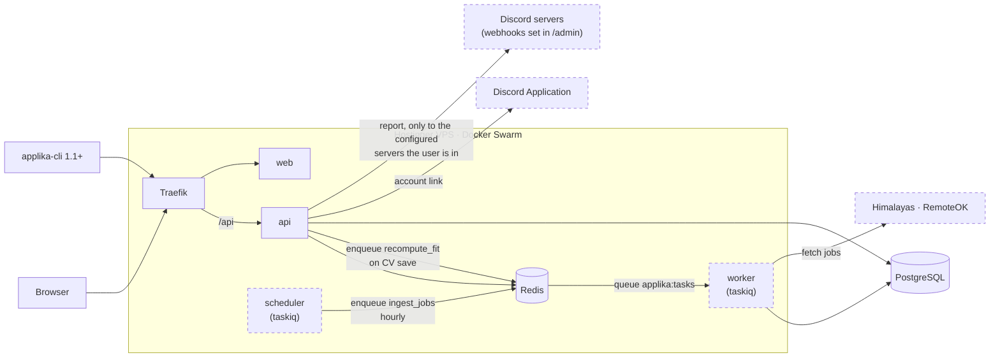

### 10.3 The Jobs feature and the worker

The worker exists for the Jobs feature: shipping Jobs means shipping the worker and the scheduler.

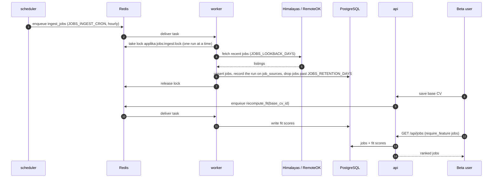

- An admin can also start a collection by hand (`POST /api/admin/jobs/runs`).
- The worker writes only jobs, sources and fit scores. It never touches applications or CVs.
- The worker never runs Alembic: in the stack it starts after the API, once the migration ran.

### 10.4 Discord account link and reports

Feedback and reports are two different paths:

- **Feedback** goes to the single `DISCORD_FEEDBACK_WEBHOOK` (Brunno's Discord). It is in production.
- **Reports** never use that webhook. They depend on the Discord App integration (account link) and
  on the report webhooks an admin configures in the admin panel (`/api/admin/discord-webhooks`):
  one webhook per Discord server, optionally limited to some role ids.

When a user submits a report (`POST /api/reports`), the backend:

1. checks whether the user connected their account with Discord; if not, the report is saved and
   posted nowhere;
2. uses the stored (encrypted) refresh token to get a fresh access token from the Discord App, and
   lists the servers (guilds) the user is in;
3. loads the report webhooks configured for those servers;
4. for a webhook limited by roles, keeps it only if the user has one of those roles in that server;
5. posts the report to every webhook left, mentioning the user.

The access token, the server ids and the role ids are read fresh on every report and never stored.

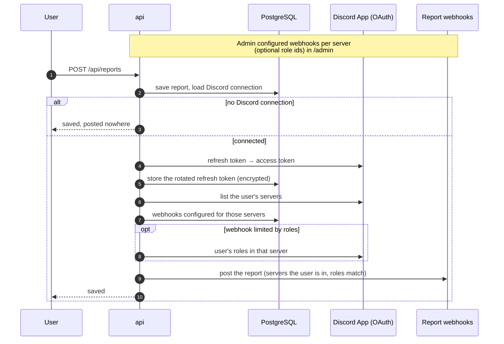

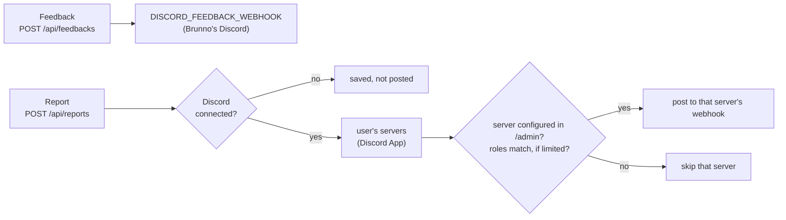

## 11. Accounts to transfer

Every account in Brunno's or Luis's personal name, plus the repository.

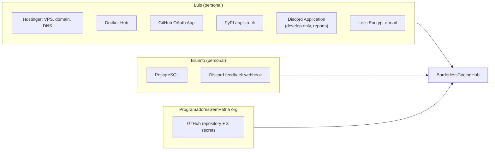

| Account | Owner today | Destination | Status |
|---|---|---|---|
| GitHub repository `ProgramadoresSemPatria/applika` | ProgramadoresSemPatria org | BorderlessCodingHub | to transfer |
| GitHub Secrets of the repository (3) | admins of the main repository | repository on BorderlessCodingHub | to transfer |
| GitHub OAuth App (login) | Luis (personal) | BorderlessCodingHub org | to transfer |
| Discord Application (account link, develop only) | Luis (personal) | Borderless | to transfer |
| Discord of the feedback webhook | Brunno (personal) | Borderless Discord | to transfer |
| Docker Hub (images) | Luis (personal) | Borderless Docker Hub org | to transfer |
| Hostinger VPS (with the Docker secrets and Redis) | Luis (personal) | Borderless account | to transfer |
| PostgreSQL and backups | Brunno (personal) | Borderless | to transfer |
| Domain registration `applika.dev` (Hostinger) | Luis (personal) | Borderless | to transfer |
| DNS (Hostinger) | Luis (personal) | Borderless | to transfer |
| PyPI `applika-cli` | Luis (personal) | Borderless PyPI organisation | to transfer |

Repository notes:

- `github.com/luis0ares/applika` is Luis's personal fork, used for development. It is not the
  production repository.
- `cli/pyproject.toml` already declares `github.com/ApplikaDev/applika` as the repository URL;
  update it to the BorderlessCodingHub URL after the move.
- A GitHub repository transfer keeps the secrets; a re-created repository does not. In that case
  re-create the three secrets of section 6.1 and the `pypi` environment.
- Archive `ProgramadoresSemPatria/applika`, or leave a notice in its README pointing to the new one.
