# Applika.dev infrastructure

How the parts of Applika connect: where each part runs, who owns each account, and which parts exist
only on `develop` so far. It also lists the accounts that must move to the BorderlessCodingHub.

> **This document holds no password, token or key.** It only says where each secret is stored and
> who can reach it.

Legend:

- **to transfer**: an account in Brunno's or Luis's personal name that must move to Borderless.
- **to confirm with Brunno**: Luis does not have this information; Brunno manages it.

Gathered on 2026-10-19 from the repository (`.github/workflows/`, `backend/app/config/settings.py`,
`backend/app/worker/`, `docker-compose.yml`, `cli/pyproject.toml`, `docs/adr/`) and the owner's answers.

---

## 1. The big picture

Production is one Hostinger VPS running a Docker Swarm stack, plus a Postgres database that Brunno
manages outside it. Traefik receives every request for `applika.dev` and routes it by path: `/api`
goes to the API, everything else goes to the frontend.

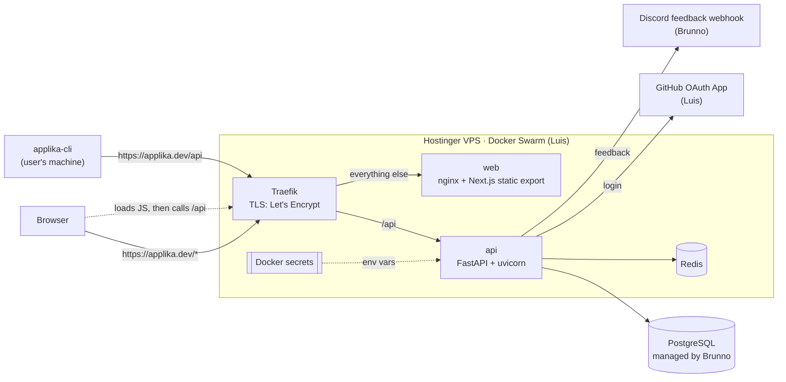

| Part | Runs where | What it does |
|---|---|---|
| Traefik | swarm service on the VPS | TLS termination (Let's Encrypt) and path routing for `applika.dev` |
| `web` | swarm service, image `<DOCKER_HUB_USER>/<frontend image>:latest` | nginx serving the Next.js **static export**. No server-side rendering: the browser downloads the app and calls the API itself |
| `api` | swarm service, image `<DOCKER_HUB_USER>/<backend image>:api-latest` | FastAPI under the `/api` prefix. All business logic, auth, CV PDF rendering (RenderCV + Typst inside the container) |
| Redis | swarm service on the VPS | Refresh-token / login state and the GitHub data cache |
| PostgreSQL | managed database, Brunno's account | All persistent data |
| `applika-cli` | the user's machine, installed from PyPI | Talks to the same API as the web, at `https://applika.dev/api` |

## 2. How a request flows

The browser and the CLI never talk to the database or Redis. Everything goes through the API.

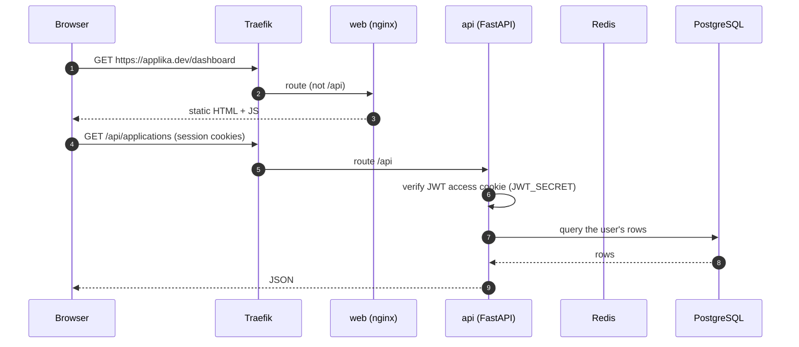

- The frontend's API address (`API_BASE_URL`) is **baked in at build time** by
  `frontend-cd.yaml`, so changing it means rebuilding the `web` image.
- The web and the API share the host `applika.dev`, so the session cookies (`__access`,
  `__refresh`) are sent to the API on every call.
- `ENVIRONMENT=PROD` hides `/api/openapi.json` and `/api/docs`.

## 3. Authentication

**In production today** GitHub OAuth is the only login ([ADR-0002](adr/0002-github-oauth-sole-login.md)), for both the web
and the CLI, as below. **Not in production yet**: Sign in with Borderless through OpenID Connect
replaces it ([ADR-0026](adr/0026-borderless-openid-connect-sign-in.md), amending ADR-0024 and ADR-0019): applika is a
confidential client of Borderless, the GitHub login goes, and GitHub only restores a pre-Borderless
account's data once. The flow, the token storage and the release are in section 10.5.

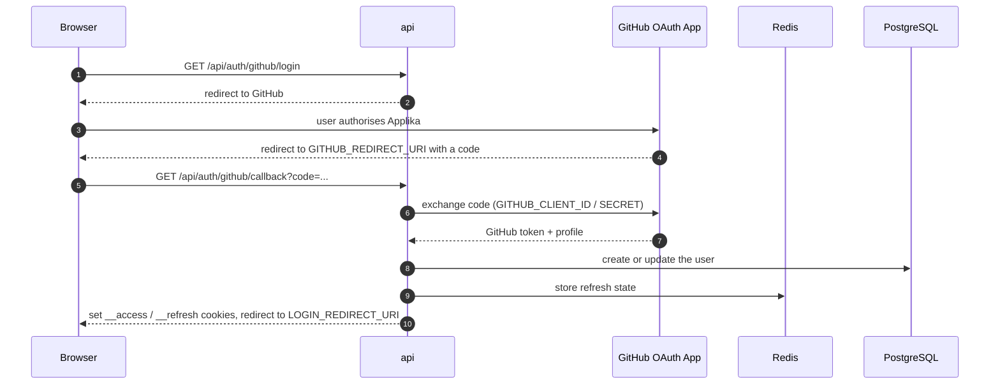

The CLI (`applika login`) uses the same GitHub OAuth App through a hand-off: the API opens the
login in the browser and the CLI receives its tokens at the end. The GitHub token the API keeps is
encrypted with `GITHUB_TOKEN_ENCRYPTION_KEY` (Fernet).

## 4. Database

| Item | Status |
|---|---|
| Engine | PostgreSQL |
| Management | Managed by **Brunno**. Luis has no access to the database or its provider. The API connects through `DATABASE_URL` (Docker secret, section 6.2) |
| Provider / region / instance name | **to confirm with Brunno** |
| Owning account | **Brunno** (personal). **to transfer** |
| Access | Brunno only; the API, through `DATABASE_URL` |
| Migrations | Automatic: Coolify runs `alembic upgrade head` as the API's post-deployment command (section 5) |
| Backup | **to confirm with Brunno** (provider backups: frequency, retention, how to restore). The repository has no backup routine |
| Schema rollback | `alembic downgrade <previous_revision>` inside the container, point the stack back to the previous image tag, restart |

Migrations follow **expand first, code second**: a release ships an additive migration with code
that still works on the old schema; the code that uses the new objects ships in a later release,
after the migration ran. Upgrades never drop a column or table; retired ones are renamed `_old`, so
a downgrade restores the data.

## 5. Build and deploy

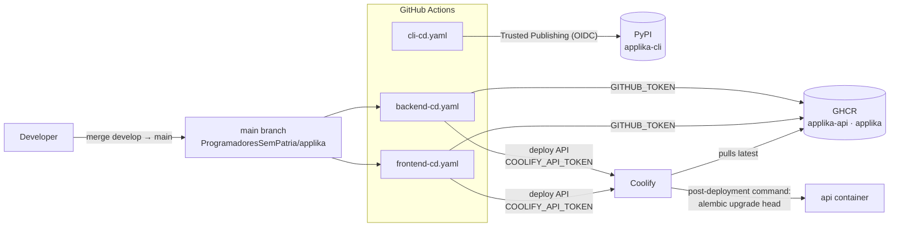

1. A merge to `main` makes GitHub Actions build the images and push them to GHCR
   (`ghcr.io/<owner>/applika-api:latest` for the API, `ghcr.io/<owner>/applika:latest` for the
   frontend). Only `latest` is kept: the job deletes untagged versions after each push.
2. A deploy job per resource calls Coolify's deploy API with its UUID; Coolify pulls `latest` and
   restarts it. The backend has three optional jobs (API, worker, scheduler), each skipped when its
   UUID variable is unset; the frontend has one, optional the same way.
3. Coolify runs `alembic upgrade head` in the new API container as its post-deployment command,
   right after the rolling update. Only the API carries it: the worker and scheduler never run
   Alembic. Between steps 2 and 3, the new code already serves against the old schema for a few
   seconds; that is why migrations ship expand first. The command's output is only in the
   deployment's debug log in Coolify: check it after a release that ships a migration.
4. The CLI is published to PyPI by `cli-cd.yaml` (`uv publish`, Trusted Publishing, environment `pypi`).

CI runs on every PR: `backend-ci.yaml` (ruff, pytest), `frontend-ci.yaml` (lint, unit tests, build,
and Playwright e2e against the real stack from `docker-compose.e2e.yml`), `cli-ci.yaml`.

| Item | Status |
|---|---|
| Hosting | **Hostinger** VPS with Docker Swarm |
| VPS owner | **Luis** (personal). **to transfer** |
| Access | Luis only (Hostinger panel and SSH) |
| Image registry | GitHub Container Registry, `latest` only |

### 5.1 Coolify

Coolify (`https://coolify.applika.dev`, version 4.7) runs the production stack on its own server
(`localhost` in Coolify). Everything lives in one project, **Applika**, environment `production`.
Coolify's proxy (Traefik) routes the domains and issues the certificates.

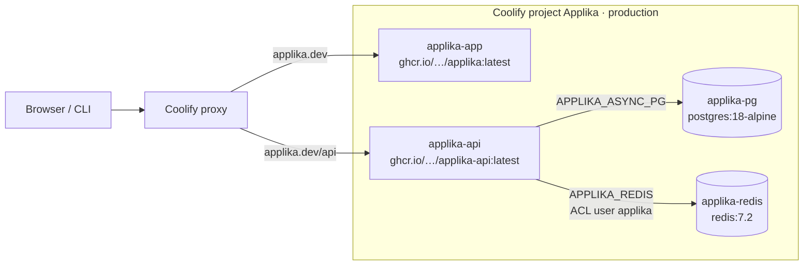

| Resource | Kind | UUID | Configuration |
|---|---|---|---|
| `applika-api` | Application, Docker image `ghcr.io/borderlesscodinghub/applika-api:latest` | `xdqutixwopha4sffdeqp8rpa` | Domains `https://applika.dev/api`, `https://www.applika.dev/api`; redirect to non-www; port 8000; start command from the image (`uvicorn`); post-deployment command `alembic upgrade head`; health check off |
| `applika-app` | Application, Docker image `ghcr.io/borderlesscodinghub/applika:latest` | `oo7rcg6j3gnjisud5it5vpem` | Domains `https://applika.dev`, `https://www.applika.dev`; redirect to non-www; port 80; no environment variables (`API_BASE_URL` is baked in at build time, section 6.1); health check off |
| `applika-pg` | Standalone PostgreSQL, `postgres:18-alpine` | `m3zregpieutzglqxsyb59bra` | Database `applika`, user `postgres`; not public |
| `applika-redis` | Standalone Redis, `redis:7.2` | `dkfscsf1yewx2fwr3c5lsscb` | Not public; ACL user `applika` (below) |

The UUIDs are what the CD workflows deploy (`COOLIFY_API_UUID`, `COOLIFY_FRONTEND_UUID`, section
6.1). A deploy is `POST <COOLIFY_URL>/api/v1/deploy?uuid=<uuid>&force=false` with a Coolify API token
that has the `deploy` permission as a Bearer header.

**API environment.** The API's runtime variables are the ones in section 6.2, set on `applika-api`
in Coolify (normal and preview copies), plus `ACCOUNT_LINK_REDIRECT_URI`, `DEVICE_VERIFICATION_URI`
and `CLI_MANUAL_REDIRECT_URI`. The two connection strings are not typed on the API: they reference
**project shared variables**, so the database and Redis credentials live in one place:

| API variable | Value | Shared variable holds |
|---|---|---|
| `DATABASE_URL` | `{{ project.APPLIKA_ASYNC_PG }}` | `postgresql+asyncpg://` URL to `applika-pg` over its internal hostname (the UUID), port 5432 |
| `REDIS_URL` | `{{ project.APPLIKA_REDIS }}` | `redis://applika:…@` URL to `applika-redis` over its internal hostname (the UUID), port 6379, db 0 |

**Redis ACL user.** Coolify's `REDIS_USERNAME` field only shapes the connection URL it shows; it does
not create the user in Redis, which then refuses `applika` with `invalid username-password pair`
(the API logs `rate_limit_unavailable` and `Session store unavailable`). The user is created by the
resource's custom Redis configuration:

```
user applika on #<sha256 of REDIS_PASSWORD> ~* &* +@all
```

Only the SHA-256 hash of the password is stored, never the password. When the password rotates,
update this hash, `APPLIKA_REDIS`, then restart Redis and the API. Through Coolify's API (or MCP),
`redis_conf` must be sent base64-encoded. The `default` user stays enabled with the same password:
Coolify sets it with `--requirepass` and its health check signs in with it. The application only
uses `applika`.

**Migrations.** `applika-api`'s post-deployment command, `alembic upgrade head`, runs inside the new
container after the rolling update (section 5, step 3). It must stay only that command: the image
already starts `uvicorn`, so a second one there fails on port 8000. Its output is only in the
deployment's debug log.

## 6. Secrets and configuration

There is no Vault, Doppler or Vercel. Secrets live in two places.

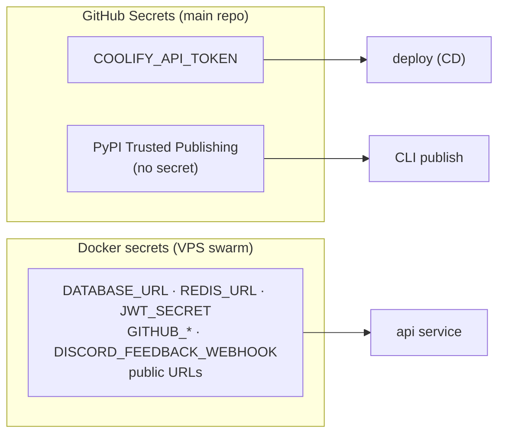

### 6.1 GitHub Secrets (Settings → Secrets and variables → Actions, main repository)

One secret and six variables. Images go to GHCR with the workflow's own `GITHUB_TOKEN`
(`packages: write`), and the CLI publishes to PyPI through Trusted Publishing (OIDC), so neither
needs a stored credential.

| Name | Kind | Purpose | Used in |
|---|---|---|---|
| `COOLIFY_API_TOKEN` | secret | Coolify API token with the `deploy` permission | `backend-cd.yaml`, `frontend-cd.yaml` |
| `COOLIFY_URL` | variable | Coolify base URL, e.g. `https://coolify.example.com` | `backend-cd.yaml`, `frontend-cd.yaml` |
| `COOLIFY_API_UUID` | variable | UUID of the Coolify API resource (`applika-api`); its deploy job is skipped when unset | `backend-cd.yaml` |
| `COOLIFY_WORKER_UUID` | variable | UUID of the Coolify taskiq worker resource (`applika-api`); its deploy job is skipped when unset | `backend-cd.yaml` |
| `COOLIFY_SCHEDULER_UUID` | variable | UUID of the Coolify taskiq scheduler resource (`applika-api`); its deploy job is skipped when unset | `backend-cd.yaml` |
| `COOLIFY_FRONTEND_UUID` | variable | UUID of the Coolify resource running `applika`; its deploy job is skipped when unset | `frontend-cd.yaml` |
| `API_BASE_URL` | variable | Baked into the frontend image at build time | `frontend-cd.yaml` |

### 6.2 Runtime environment (Docker secrets on the VPS)

Stored as **Docker Swarm secrets** on the VPS (Hostinger, Luis's account). Access: whoever has SSH to
the VPS, today Luis. To list them without reading values: `docker secret ls`.

| Variable | What it is |
|---|---|
| `DATABASE_URL` | Postgres connection |
| `REDIS_URL` | Redis connection |
| `JWT_SECRET` | signs the session JWTs |
| `GITHUB_CLIENT_ID`, `GITHUB_CLIENT_SECRET`, `GITHUB_REDIRECT_URI` | GitHub OAuth (one-shot data restore) |
| `DISCORD_FEEDBACK_WEBHOOK` | Discord webhook that receives user feedback (feedback only, not reports) |
| `CORS_ORIGINS`, `WEB_SIGNIN_URI` | public URLs |
| `ENVIRONMENT=PROD` | configuration |

From the Borderless sign-in release (section 10.5), on the API service (the worker and the scheduler
share its environment):

| Variable | What it is |
|---|---|
| `BORDERLESS_ISSUER` | Borderless's OpenID Connect issuer, `https://api.borderlesscoding.com/api/auth` (https in PROD) |
| `BORDERLESS_CLIENT_ID` | applika's client id at Borderless |
| `BORDERLESS_CLIENT_SECRET` | applika's client secret at Borderless (a Docker secret or env value only, never git) |
| `BORDERLESS_REDIRECT_URI` | `https://applika.dev/api/auth/borderless/callback`, exactly the address registered at Borderless |
| `BORDERLESS_TOKEN_ENCRYPTION_KEY` | Fernet key for the Borderless refresh token (Postgres) and access token (Redis); back it up with the stack secrets: losing it ends every web session at its next membership check |
| `WEB_SIGNIN_URI` | the web sign-in page, `https://applika.dev/login`, where every sign-in ends |

Without the issuer, the client id, the secret or the key the API still boots, and the sign-in sends
the browser back with `?error=AUTH-1018`. `BORDERLESS_API_URL` and the per-email sign-in limit of the
password era are gone.

## 7. Domain and TLS

| Item | Status |
|---|---|
| Domain | `applika.dev` (site) and `applika.dev/api` (API, the CLI's default) |
| Registrar | **Hostinger** |
| Registration owner | **Luis** (personal). **to transfer** |
| DNS | **Hostinger** (same account as the registration) |
| TLS | Let's Encrypt, issued and renewed by Traefik. The certificate is signed with **Luis's personal e-mail**; when migrating, change the e-mail in the Traefik configuration |

## 8. Third-party services

| Service | Use | Provider | Owning account |
|---|---|---|---|
| Login | Only login for the web and the CLI ([ADR-0002](adr/0002-github-oauth-sole-login.md)) | GitHub OAuth App | **Luis** (personal). **to transfer** to the Borderless org |
| Login (not in production yet) | Sign in with Borderless: applika's OpenID Connect client at Borderless (confidential, PKCE S256, `client_secret_basic`), the membership claim for the BASE and PSP badges (section 10.5) | Borderless (`api.borderlesscoding.com`) | **Borderless** registered the client on the owner's request; its only redirect URI is `https://applika.dev/api/auth/borderless/callback`. The secret lives only in the VPS environment |
| Feedback | Users' feedback (`POST /api/feedbacks`) is posted to Discord by the `DISCORD_FEEDBACK_WEBHOOK` webhook (none received so far). Reports do not use this webhook (section 10.4) | Discord | **Brunno** (personal). **to transfer** |
| CV PDF | RenderCV + Typst inside the API container | local | no account |
| E-mail | None: the product sends no e-mail | — | — |
| Analytics | None: the cookie policy states there are no analytics cookies | — | — |
| AI APIs | None: fit score and tailoring are computed in the backend, without an LLM | — | — |

## 9. CLI

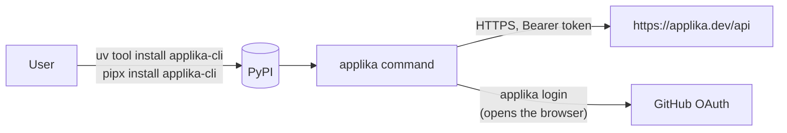

| Item | Status |
|---|---|
| Package | `applika-cli` on **PyPI** (not npm): `pypi.org/project/applika-cli` |
| Publishing | `cli-cd.yaml` with `uv publish --trusted-publishing always` in environment `pypi`: the PyPI project trusts this repository, workflow `cli-cd.yaml` and environment `pypi`; no token |
| Authors in the package | Luis Eduardo Soares, David Alecrim (`cli/pyproject.toml`) |
| PyPI owner | **Luis** (personal). **to transfer**: create a Borderless organisation or account on PyPI and add it as owner |
| Compatibility | Users do not upgrade in lockstep with the API, so routes a published CLI version calls are never broken |
| Recommendation | Replace the token with PyPI Trusted Publishing pointing at the new repository |

## 10. On `develop` only (not in production yet)

These parts exist in the code on the `develop` branch but **do not run in production** today. New
user-facing features start in **beta**: only users on a feature's beta list see it, and an admin
releases it to everyone from `/admin/features` ([ADR-0018](adr/0018-beta-features-registry-and-allowlist.md)). Nothing on this list is deployed yet.

### 10.1 What each piece needs

| Piece | What it is | Depends on | Infrastructure it will need |
|---|---|---|---|
| Beta features registry | `features` table, beta lists, `/admin/features` ([ADR-0018](adr/0018-beta-features-registry-and-allowlist.md)). Gates the two beta features below | Postgres | Release migration only |
| **CVs** (beta, key `cvs`) | CV builder: base CVs, tailored CVs, PDF export ([ADR-0011](adr/0011-server-side-cv-pdf-rendercv.md)) | API, Postgres | Nothing new (RenderCV + Typst ship in the API image) |
| **Jobs** (beta, key `jobs`) | Job board: hourly collection of remote jobs, saved searches, fit score against the user's CV ([ADR-0017](adr/0017-keyword-tailoring-and-fit-score.md)) | the **worker**, the **scheduler**, Redis, Postgres | APIs Himalayas and RemoteOK (public, no account); env `JOBS_*` |
| Worker (taskiq) | Background tasks, same image as the API ([ADR-0016](adr/0016-taskiq-worker-for-background-jobs.md)). Exists **for the Jobs feature** | Redis (queue `applika:tasks`), Postgres | A swarm service; the CD already updates `SWARM_WORKER_SERVICE_NAME` if it exists |
| Scheduler (taskiq) | Enqueues `ingest_jobs` on `JOBS_INGEST_CRON` (hourly). Exactly one runs | Redis | A swarm service (`SWARM_SCHEDULER_SERVICE_NAME`) |
| Rate limiter | Per-user limit with IP fallback, fixed window in Redis ([ADR-0015](adr/0015-redis-api-rate-limiter.md)) | Redis | env `RATE_LIMIT_*`, `FORWARDED_ALLOW_IPS` (Traefik as trusted proxy) |
| Device sessions and new CLI sign-in | CLI 1.1.0: PKCE and device-code login, list and revoke devices ([ADR-0019](adr/0019-device-sessions-and-cli-oauth.md)) | Redis, Postgres | env `DEVICE_VERIFICATION_URI`, `CLI_MANUAL_REDIRECT_URI` |
| Discord account link and report routing | User connects Discord on the profile; reports go to the Discord servers configured in the admin panel that the user is a member of ([ADR-0008](adr/0008-discord-linked-account.md), [ADR-0013](adr/0013-discord-connection-and-report-webhook-routing.md)) | Discord Application, the report webhooks configured at `/admin` | env `DISCORD_CLIENT_ID`, `DISCORD_CLIENT_SECRET`, `DISCORD_LINK_REDIRECT_URI`, `DISCORD_TOKEN_ENCRYPTION_KEY`, `ACCOUNT_LINK_REDIRECT_URI`; Discord Application on Luis's personal account (**to transfer**) |

### 10.2 Target topology

What the stack looks like once the `develop` work ships. Dashed parts are the new ones.

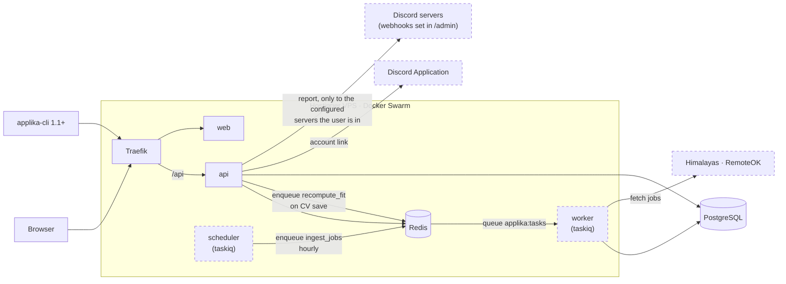

### 10.3 The Jobs feature and the worker

The worker exists for the Jobs feature: shipping Jobs means shipping the worker and the scheduler.

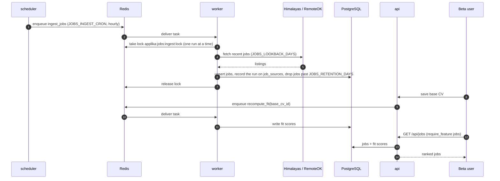

- An admin can also start a collection by hand (`POST /api/admin/jobs/runs`).
- The worker writes only jobs, sources and fit scores. It never touches applications or CVs.
- The worker never runs Alembic: in the stack it starts after the API, once the migration ran.

### 10.4 Discord account link and reports

Feedback and reports are two different paths:

- **Feedback** goes to the single `DISCORD_FEEDBACK_WEBHOOK` (Brunno's Discord). It is in production.
- **Reports** never use that webhook. They depend on the Discord App integration (account link) and
  on the report webhooks an admin configures in the admin panel (`/api/admin/discord-webhooks`):
  one webhook per Discord server, optionally limited to some role ids.

When a user submits a report (`POST /api/reports`), the backend:

1. checks whether the user connected their account with Discord; if not, the report is saved and
   posted nowhere;
2. uses the stored (encrypted) refresh token to get a fresh access token from the Discord App, and
   lists the servers (guilds) the user is in;
3. loads the report webhooks configured for those servers;
4. for a webhook limited by roles, keeps it only if the user has one of those roles in that server;
5. posts the report to every webhook left, mentioning the user.

The access token, the server ids and the role ids are read fresh on every report and never stored.

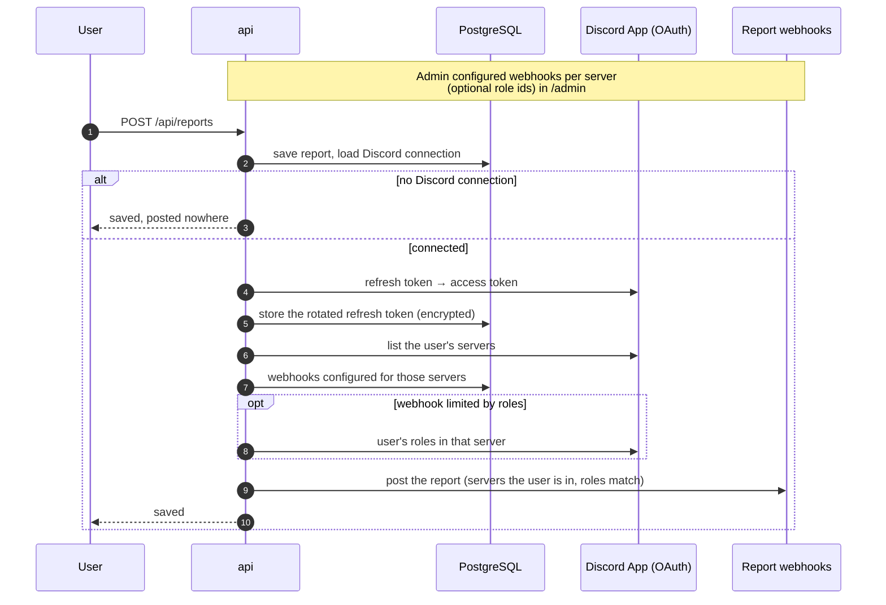

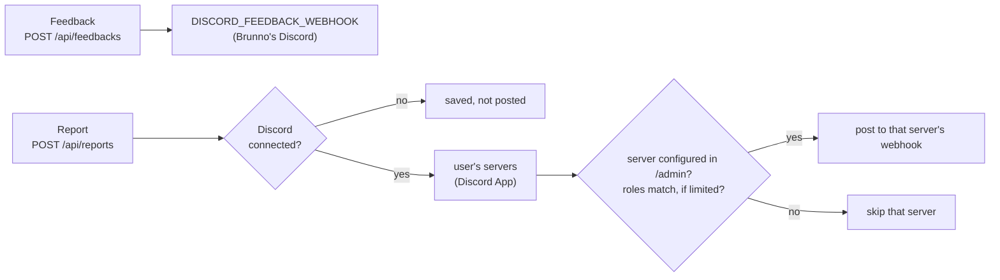

### 10.5 Sign in with Borderless (OpenID Connect)

[ADR-0026](adr/0026-borderless-openid-connect-sign-in.md), PRD 0020. Applika never sees a Borderless password.

- `GET /api/auth/borderless/login` sends the browser to Borderless's authorize endpoint (from the
  issuer's discovery document) with a fresh `state` (a random UUID), a `nonce` and a PKCE S256
  challenge. The attempt lives ten minutes in Redis (`applika:borderless:login:<state>`), single use,
  with the target to redirect to after sign-in (the web sign-in page, or the CLI's loopback or
  manual-code page), bound to the browser by applika's own HttpOnly `__applika_login` cookie. A web
  sign-in sends no `prompt` (a Borderless browser
  session makes it one click); a CLI sign-in (`/api/auth/cli/authorize`, `/api/auth/cli/login/{id}`)
  sends `prompt=login`, so Borderless always asks. `applika login --device` does not use Borderless.
- `GET /api/auth/borderless/callback` checks the cookie, the `state`, the stored target (checked again
  against the allowed targets; any other is refused, never followed, and no query value decides it)
  and `iss`, exchanges the code with HTTP Basic, the verifier and the redirect URI, and verifies the
  id_token (EdDSA, issuer, audience, expiry, nonce). It redirects to the stored target. Web: a
  `borderless` session and its cookies. CLI: the code goes back to the CLI's loopback or manual-code
  page. A refusal lands on `/login?error=<code>`. The request log
  writes the callback's query as `?[redacted]`.
- One Borderless grant per user. The **refresh token** lives only in Postgres
  (`borderless_accounts.encrypted_refresh_token`), Fernet-encrypted, rotated on every use. The
  **access token** never enters Postgres: it lives Fernet-encrypted in Redis
  (`applika:borderless:access:<user_id>`), expiring with the token (about an hour). Its presence means
  the membership read is current.
- The membership (`borderless_membership` in the id_token: BASE, PSP) is re-read when the Redis key is
  gone, at a session refresh or a member-gated request (the reports): about one Borderless call per
  hour per active user. No scheduled job. Borderless slow or down never ends a session.
- `invalid_grant` (30 days after the sign-in, or access revoked): every web session of the user ends
  `borderless_revoked` and the web asks for a new sign-in (AUTH-1049); CLI sessions stay signed in
  and their member-gated requests answer AUTH-1050 until the next sign-in.
- The user's last session ending (logout, device revocation, account deletion) revokes the refresh
  token at Borderless, best effort, after answering. The Borderless browser session is never touched.
- Tests, the E2E stack and local runs use the fake Borderless
  (`backend/tests/fixtures/borderless/fake_oidc.py`, synthetic accounts in `accounts.json`): the E2E
  service `borderless-fake` runs it from its own test-only image (`applika-e2e-borderless-fake`, built
  from `backend/tests/fixtures/borderless/Dockerfile`), never the API image (issuer
  `http://borderless-fake:8081/api/auth`, the browser reaches it at `http://127.0.0.1:8181`, access
  tokens of 2 seconds), locally
  `cd backend && uv run python tests/fixtures/borderless/fake_oidc.py --port 8081 --issuer http://127.0.0.1:8081/api/auth`.
  The real Borderless lists only the production redirect URI, so nothing but production reaches it.

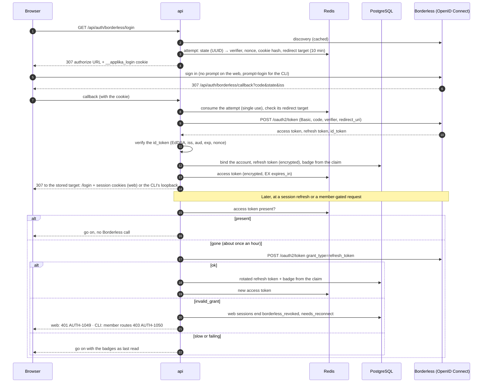

**Release** (plan 0020 `## Release`): the revision `f823e8c34e01` ships with its code, together with
the Borderless sign-in of PRD 0018, in one human release from `develop` to `main`. Set the six
variables of section 6.2 on the API service before the push; the deploy then runs `alembic upgrade
head` through the API's post-deployment command, as for every release.

## 11. Accounts to transfer

Every account in Brunno's or Luis's personal name, plus the repository.

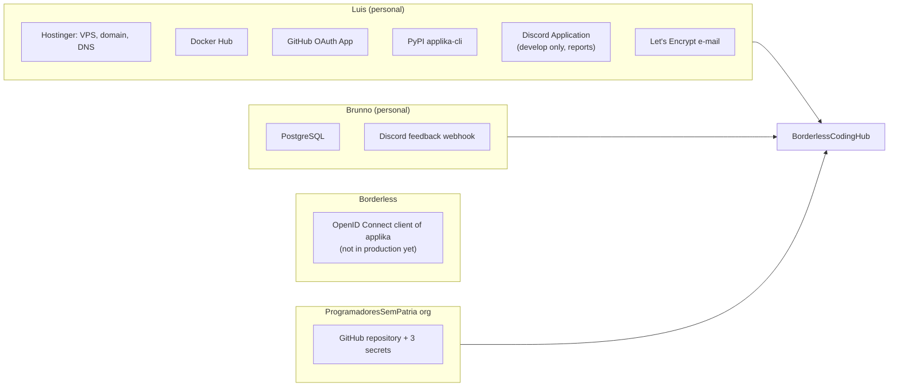

| Account | Owner today | Destination | Status |
|---|---|---|---|
| GitHub repository `ProgramadoresSemPatria/applika` | ProgramadoresSemPatria org | BorderlessCodingHub | to transfer |
| GitHub Secrets of the repository (3) | admins of the main repository | repository on BorderlessCodingHub | to transfer |
| GitHub OAuth App (login) | Luis (personal) | BorderlessCodingHub org | to transfer |
| Discord Application (account link, develop only) | Luis (personal) | Borderless | to transfer |
| Discord of the feedback webhook | Brunno (personal) | Borderless Discord | to transfer |
| Docker Hub (images) | Luis (personal) | Borderless Docker Hub org | to transfer |
| Hostinger VPS (with the Docker secrets and Redis) | Luis (personal) | Borderless account | to transfer |
| PostgreSQL and backups | Brunno (personal) | Borderless | to transfer |
| Domain registration `applika.dev` (Hostinger) | Luis (personal) | Borderless | to transfer |
| DNS (Hostinger) | Luis (personal) | Borderless | to transfer |
| PyPI `applika-cli` | Luis (personal) | Borderless PyPI organisation | to transfer |
| Borderless OpenID Connect client of applika (client id, secret, redirect URI) | Borderless, registered on the owner's request | stays with Borderless; the owner asks Borderless for any change (a new redirect URI, a new secret) | nothing to transfer |

Repository notes:

- `github.com/luis0ares/applika` is Luis's personal fork, used for development. It is not the
  production repository.
- `cli/pyproject.toml` already declares `github.com/ApplikaDev/applika` as the repository URL;
  update it to the BorderlessCodingHub URL after the move.
- A GitHub repository transfer keeps the secrets; a re-created repository does not. In that case
  re-create the three secrets of section 6.1 and the `pypi` environment.
- Archive `ProgramadoresSemPatria/applika`, or leave a notice in its README pointing to the new one.
